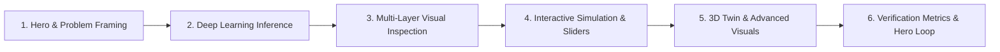

# Universal UI Scraping, Exploration & Screen Recording Specification
**The General Standard for Automated Showcase Recording across All Future Projects**

> **Battle-Tested Standard**: This specification defines the universal, hardened standard for automated UI exploration, dynamic user simulation, and broadcast-quality Full HD / 4K video recording. It has been refined, validated, and proven on complex deep-learning applications featuring PyTorch models, local FastAPI backends, reactive Streamlit interfaces, and hardware-accelerated 3D WebGL digital twins.
>
> Any future project added to this pipeline—whether running on a local development port or deployed to cloud platforms (Vercel, AWS, HuggingFace)—must adhere to these universal rules.

---

## 1. Core Mission & Foundational Principles

### 1.1 Zero Artificial Time Limits
Every showcase video must be **unhurried, thorough, and exhaustive**.
- There is **no arbitrary cap** (e.g., 15s or 30s).
- The recording length is determined strictly by the project's complexity: whether a project requires **60 seconds, 90 seconds, or 2.5 minutes** to showcase every single model and view, it is granted the full duration needed.
- Pacing must feel like an expert senior engineer giving a live, confident product walkthrough to prospective employers and technical leads.

### 1.2 100% Feature Inventory Coverage
A project demonstration must **never** be a shallow skim:
- Every navigation tab, sub-view, model toggle, input slider, dropdown selector, visual canvas, and technical metric table must be visited and demonstrated **sequentially one by one**.
- If a project includes 7 tabs, all 7 tabs must be opened and explored. If it includes 3D simulations, the 3D viewport must be centered and interacted with.

---

## 2. Localhost Server Lifecycle & Process Management Rules

When recording projects hosted locally on the user's laptop (FastAPI, Streamlit, Flask, Node.js, Next.js, Gradio):

### Rule 2.1: The "No-Pipe-Buffer" Rule (Zero Deadlocks)
- **Windows Buffer Limitation**: Never use `subprocess.Popen(..., stdout=subprocess.PIPE, stderr=subprocess.PIPE)` on Windows for long-running servers. Windows pipe buffers are limited to 4 KB to 64 KB; once full, the child process hangs indefinitely and never responds.
- **Persistent Log Redirection**: Server `stdout` and `stderr` must always be directed to a dedicated log file:
  ```python
  log_file = open(f"logs/server_{project_name}.log", "w", encoding="utf-8")
  process = subprocess.Popen(cmd, stdout=log_file, stderr=log_file, cwd=project_dir)
  ```
- This ensures zero pipe deadlock, fast server initialization (< 8 seconds), and a persistent log audit trail for troubleshooting.

### Rule 2.2: Port Health-Checking Before Browser Launch
- The automation must poll `http://127.0.0.1:<PORT>` (or `http://localhost:<PORT>`) using lightweight HTTP socket or `urllib.request` pings with an exponential backoff before launching Playwright.
- Only when an HTTP `200 OK` is returned does Playwright open the browser context.

### Rule 2.3: Virtual Environment Isolation
- Always prioritize the project's own virtual environment (`.\venv\Scripts\python.exe` or `.\env\Scripts\python.exe`) over the global system Python to guarantee PyTorch, CUDA, and library dependencies match the project's runtime requirements.

### Rule 2.4: Clean Server Teardown
- Upon recording completion (or on error), the runner must terminate the server process tree cleanly, releasing the bound port so future runs never encounter `Errno 10048 (Address already in use)`.

---

## 3. The 6-Phase Golden Interaction Blueprint

Every future project should structure its user journey across these six consecutive phases:



### Phase 1: Header & Problem Framing (0s – 15s)
- **Hover on Brand / Header**: Glide cursor to the title badge and research headline (dwell 2.5s).
- **Executive Scroll**: Smoothly scroll down 350px to display problem framing, architecture diagrams, and system context.
- **Return to Nav**: Smoothly scroll back to the navigation bar.

### Phase 2: Live Deep Learning / ML Model Inference (15s – 40s)
- **Navigate to Core Model Tab**: Switch to the primary computer vision, NLP, or predictive modeling view.
- **Trigger Inference**: Click the primary action button (`"Run U-Net Segmentation"`, `"Predict Churn"`, `"Generate Embeddings"`, `"Classify Image"`).
- **Inference Dwell**: Allow **4.0 to 5.0 seconds** for loading spinners to resolve and the output to materialize on screen.

### Phase 3: Multi-Layer / Multimodal Inspection (40s – 65s)
- **Cycle Output Layers**: For computer vision and geospatial models, click through:
  - Raw Input Scene / Optical Image
  - Predicted Segmentation Mask / Heatmap
  - Blended Overlay (Alpha blending input with predictions)
  - Anomaly Heatmap / Gradient Attribution (Grad-CAM)
- **Dwell**: Spend **3.5 seconds** per layer so viewers inspect the boundary precision.

### Phase 4: Interactive Simulation & What-If Sliders (65s – 90s)
- **Adjust Parameters**: Glide cursor to dynamic sliders (`input[type='range']`) or dropdowns.
- **Value Modulation**: Modify values (e.g., Solar Radiation $\rightarrow$ 850 W/m², Greening Target $\rightarrow$ 35%, Threshold $\rightarrow$ 0.75).
- **Inspect Counterfactuals**: Scroll down to display live recalculations, delta curves, and cooling/saving metrics.

### Phase 5: 3D Digital Twin, WebGL & Advanced Visualizations (90s – 115s)
- **Navigate to 3D Viewport**: Switch to 3D / WebGL / Spatial tab.
- **Center Canvas**: Execute targeted scroll (`delta_y: 380px`) so the 3D model is vertically centered in the 1080p viewport.
- **Activate 3D Modes**: Toggle Isometric view, drape satellite imagery, or project heat relief domes.
- **Scale Extrusion**: Adjust building/terrain height extrusion slider (e.g., 2.3x).
- **Cinematic Orbit**: Enable auto-rotate or perform a smooth orbital mouse drag across the canvas for 5.0 seconds.

### Phase 6: Quantitative Performance Analytics & Clean Loop (115s – 130s)
- **Metrics & Benchmarks Tab**: Switch to verification analytics.
- **Display Telemetry**: Scroll down to showcase loss curves, confusion matrix, ROC-AUC curves, and F1/IoU benchmark scores.
- **Hero Wrap-Up**: Return to the **Overview / Hero** dashboard, center the cursor, and hold for 3.0 seconds to produce a seamless loop for LinkedIn autoplay.

---

## 4. Hardware-Accelerated 3D WebGL & Canvas Scraping Protocol

Modern AI projects increasingly incorporate 3D digital twins, Deck.gl geospatial decks, Three.js meshes, and Mapbox visualizers. The following rules are mandatory for 3D exploration:

### 4.1 WebGL Hardware Acceleration Flags
The Playwright browser instance must always launch with GPU acceleration flags:
```python
browser = playwright.chromium.launch(
    headless=True,
    args=[
        "--enable-webgl",
        "--ignore-gpu-blocklist",
        "--use-gl=angle",
        "--enable-gpu-rasterization",
        "--enable-zero-copy"
    ]
)
```

### 4.2 Viewport Vertical Centering
- **The Fold Problem**: In standard dashboards, navigation bars, control buttons, and metric ribbons consume the top 400px–500px, pushing 3D canvases partially below the viewport fold.
- **The Centering Scroll Rule**: Before interacting with a 3D canvas, always dispatch a smooth downward scroll of **350px to 400px**:
  ```json
  { "action": "scroll", "delta_y": 380, "wait_ms": 2500, "description": "Center 3D Canvas in Viewport" }
  ```
- After 3D exploration is complete, scroll back up with an identical negative scroll (`delta_y: -380`) before clicking navigation tabs.

### 4.3 3D Shader Compilation & Stabilization Buffers
- Three.js, Babylon.js, and WebGL scenes compile shaders and initialize texture buffers on the first frame.
- Always provide a **3.5 to 4.5 second dwell time** immediately after switching into a 3D tab before attempting interactions.

### 4.4 3D Manipulation Primitives
- **Isometric Perspective**: Trigger camera projection toggles (`button:has-text('Isometric')`, `#btn-cam-iso`).
- **Mesh Extrusion Scaling**: Modulate depth/height scale sliders (`#slider-height-scale`, `input[name='slider-height-scale']`).
- **Camera Orbit**: Trigger cinematic auto-rotation or dispatch synthetic drag events (`mousedown` $\rightarrow$ arc `mousemove` $\rightarrow$ `mouseup`).

---

## 5. Humanized Cursor Physics & Visual Telemetry

Mechanical cursor movements destroy viewer engagement. Every recording must simulate an expert human user through mathematical kinematics.

### 5.1 Cubic Bézier Trajectory Math
Every cursor translation between point $\mathbf{P}_0 = (x_0, y_0)$ and target $\mathbf{P}_3 = (x_3, y_3)$ is interpolated along a Cubic Bézier Curve:
$$\mathbf{B}(t) = (1-t)^3 \mathbf{P}_0 + 3(1-t)^2 t \mathbf{P}_1 + 3(1-t) t^2 \mathbf{P}_2 + t^3 \mathbf{P}_3, \quad t \in [0, 1]$$
- **Control Points ($\mathbf{P}_1, \mathbf{P}_2$)**: Computed dynamically by displacing perpendicular to the direct travel vector by a random human deflection factor ($15\%$ to $30\%$ of Euclidean distance).
- **Sinusoidal Velocity Easing**: Step interpolation follows an ease-in-out S-curve:
  $$t = \frac{1 - \cos(\pi \cdot u)}{2}, \quad u = \frac{i}{\text{total\_steps}}$$

### 5.2 Visual Cursor Design
- **Radial Depth Styling**: 20px circular pointer styled with radial gradient depth (`#ff4b4b` $\rightarrow$ `#d90429`), 2.5px crisp white border, and a 12px glowing drop-shadow.
- **Animated Click Wave Ripple**: Every click dispatches an expanding emerald green wave (`#10b981`) scaling from $1.0\times$ to $2.8\times$ with opacity decay over 650ms, giving viewers immediate visual confirmation of the interaction.

### 5.3 Hardware Momentum Scrolling
- **Dual-Mode Fluidity**: Combines `window.scrollBy({ top: delta_y, behavior: 'smooth' })` with sinusoidal deceleration wheel sub-steps:
  $$w_i = \sin\left(\frac{i+1}{\text{steps}} \cdot \pi\right)$$
- Eliminates mechanical page jumps and ensures smooth scrolling across custom `div` containers and virtualized data grids.

---

## 6. Broadcast Resolution, DPI & Video Encoding Standard

### 6.1 Recording Viewport & High-DPI Supersampling
- **Default Resolution**: **Full HD 1080p** (`1920 x 1080`).
- **High-DPI Subpixel Density**: Configured with `device_scale_factor=1.5`.
  - Charts, math equations, small numerical table text, and 3D polygon wireframes render with $1.5\times$ supersampling.
  - Guarantees zero jagged edges or blurry text when viewed on 4K monitors or mobile screens.
- **4K Ultra HD Mode**: Set `RECORDING_RESOLUTION=4k` in `.env` to record at native `3840 x 2160`.

### 6.2 Broadcast-Quality Video Encoding Parameters
Exported via MoviePy with explicit broadcast-grade flags:
| Parameter | Setting | Impact |
| :--- | :--- | :--- |
| **Codec** | `libx264` | Universal social video compatibility |
| **Pixel Format** | `yuv420p` | Guaranteed playback on iOS, Android, and LinkedIn web players |
| **Bitrate** | `12M` (12 Mbps) | Eliminates compression artifacts, macroblocking, and gradient banding |
| **Constant Rate Factor** | `-crf 18` | Visually lossless master archive quality |
| **Preset** | `medium` | Optimal balance between H.264 entropy encoding and render speed |
| **FPS** | `25.0` or `30.0` | Smooth, cinematic motion cadence |
| **Trim Start** | `2.00s` | Programmatically strips initial blank browser initialization and DNS delay |
| **Speed Factor** | `1.15x – 1.20x` | Crisp, energetic social media pacing without rushing plots |

---

## 7. Universal Framework Selectors Matrix

When onboarding new projects, use these battle-tested selectors for common web frameworks:

| Framework | Navigation Tabs | Action / Inference Buttons | Sliders & Controls | Scroll Container |
| :--- | :--- | :--- | :--- | :--- |
| **Next.js / React** | `button[data-tab]`, `nav a`, `[role="tab"]` | `button:has-text('Run')`, `button.primary` | `input[type='range']`, `.slider` | `window`, `main`, `.overflow-y-auto` |
| **Streamlit** | `.stTabs [data-baseweb="tab"]`, `[data-testid="stSidebarNav"] li` | `button[kind="primary"]`, `button:has-text('Predict')` | `[data-testid="stSlider"] input`, `input[type="range"]` | `[data-testid="stAppViewContainer"]` |
| **Gradio** | `button.tab-nav`, `.tabs button` | `button.primary`, `button:has-text('Submit')` | `input[type='range']` | `window`, `.gradio-container` |
| **FastAPI / Swagger** | `.opblock-tag-section`, `.opblock-summary` | `button.try-out__btn`, `button.execute` | Inputs within `.parameters` | `window` |
| **Dash / Plotly** | `.tab`, `button.nav-link` | `button#btn-submit`, `button:has-text('Analyze')` | `.rc-slider`, `input[type="range"]` | `window` |
| **Three.js / WebGL** | Custom tab switching to 3D | `button:has-text('Isometric')`, `#btn-cam-iso` | `#slider-height-scale`, `input[type='range']` | Target canvas parent container |

---

## 8. Standard Configuration Schema (`projects_config.json`)

To onboard any future project into the pipeline, add an entry matching this standard specification:

### 8.1 For Local Projects (Running on User's Machine)
```json
{
  "name": "my_new_ai_platform_local",
  "title": "Autonomous Medical Diagnosis & X-Ray Segmentation Platform",
  "folder_path": "C:/Projects/Medical-AI-Platform",
  "start_command": ".\\venv\\Scripts\\python.exe -m uvicorn app.main:app --port 8505",
  "url": "http://127.0.0.1:8505",
  "port": 8505,
  "wait_timeout_seconds": 60,
  "readme_path": "README.md",
  "main_script_path": "app/main.py",
  "trim_start_sec": 2.0,
  "speed_factor": 1.18,
  "interactions": [
    { "action": "hover", "selector": "header, .brand", "wait_ms": 2500, "description": "1. Overview: Highlight Platform Header & Architecture" },
    { "action": "scroll", "delta_y": 350, "wait_ms": 3000, "description": "2. Overview: Inspect Clinical Problem Framing & Pipeline Diagram" },
    { "action": "scroll", "delta_y": -350, "wait_ms": 1000, "description": "3. Overview: Return to Navigation" },
    { "action": "click", "selector": "button[data-tab='inference']", "wait_ms": 3000, "description": "4. Model Tab: Switch to Neural Inference" },
    { "action": "click", "selector": "button:has-text('Run Segmentation')", "wait_ms": 4500, "description": "5. Model Tab: Execute Deep Learning Inference" },
    { "action": "click", "selector": "button:has-text('Grad-CAM Heatmap')", "wait_ms": 3500, "description": "6. Model Tab: Inspect Model Interpretability Heatmap" },
    { "action": "click", "selector": "button[data-tab='3d-volume']", "wait_ms": 3500, "description": "7. 3D Tab: Switch to 3D Volumetric Mesh" },
    { "action": "scroll", "delta_y": 380, "wait_ms": 2500, "description": "8. 3D Tab: Center 3D Mesh in Viewport" },
    { "action": "click", "selector": "button:has-text('Isometric')", "wait_ms": 3000, "description": "9. 3D Tab: Toggle Isometric Elevation Perspective" },
    { "action": "slider", "selector": "input[type='range']", "value": "2.0", "wait_ms": 3500, "description": "10. 3D Tab: Scale Slice Extrusion Height to 2.0x" },
    { "action": "scroll", "delta_y": -380, "wait_ms": 1000, "description": "11. 3D Tab: Return to Navigation" },
    { "action": "click", "selector": "button[data-tab='analytics']", "wait_ms": 3000, "description": "12. Analytics: Switch to Validation Metrics & ROC Curves" },
    { "action": "scroll", "delta_y": 400, "wait_ms": 3500, "description": "13. Analytics: Review Confusion Matrix & F1 Scores" },
    { "action": "scroll", "delta_y": -400, "wait_ms": 1000, "description": "14. Analytics: Return to Navigation" },
    { "action": "click", "selector": "button[data-tab='overview']", "wait_ms": 3000, "description": "15. Wrap-Up: Return to Main Overview Dashboard" }
  ]
}
```

### 8.2 For Cloud Deployed Projects (Vercel, AWS, Cloudflare, HuggingFace)
```json
{
  "name": "my_cloud_platform",
  "title": "Real-Time Financial Sentiment & Transformer Forecast Platform",
  "live_url": "https://financial-transformer.vercel.app",
  "url": "https://financial-transformer.vercel.app",
  "trim_start_sec": 2.0,
  "speed_factor": 1.18,
  "interactions": [
    ...
  ]
}
```

---

## 9. Fallback Autonomous Discovery Rules (Zero-Config Mode)

If a new project does not specify an explicit `interactions` array:
1. **Multimodal Vision Analysis**: The pipeline uses Gemini Multimodal Vision to inspect the initial hero screenshot and identify the primary functional components.
2. **Deep DOM Feature Explorer**:
   - Detects all navigation tabs (`button[data-tab]`, `[role="tab"]`, `.stTabs button`).
   - Visits every tab sequentially with a 3.0s dwell.
   - Detects and triggers any action buttons (`"Run"`, `"Predict"`, `"Compute"`, `"Simulate"`, `"Analyze"`).
   - Detects any range sliders, moving them to $60\%–80\%$ of their max span.
   - Performs a full smooth vertical scroll cycle ($+400\text{px}$ down, hold 3.5s, $-400\text{px}$ up).
   - Navigates back to the first tab / hero view for a clean finish.

---

## 10. Pre-Flight Quality Assurance Checklist

Before any output video is finalized:
- [x] **Local Server Clean Boot**: Backend started without pipe buffer deadlocks; logs written to `logs/server_<name>.log`.
- [x] **All Tabs Explored**: Zero videos confined to the overview screen; 100% of feature tabs are opened.
- [x] **Live Inference Demonstrated**: Model execution buttons are clicked, with output masks/heatmaps clearly visible.
- [x] **Dynamic Parameter Modulation**: Sliders/dropdowns visibly adjust parameters and trigger reactive UI changes.
- [x] **3D Viewport Centered**: 3D canvases are scrolled into the focal center of the 1080p frame before interaction.
- [x] **Cinematic Cursor**: Smooth Bézier curves with expanding green click pulses confirm every action.
- [x] **Broadcast 1080p Export**: Encoded in H.264 `yuv420p` with CRF 18 and 12 Mbps bitrate, trimmed and paced at 1.15x–1.20x.
- [x] **Seamless Looping**: Video begins post-load and concludes on the clean hero dashboard.
